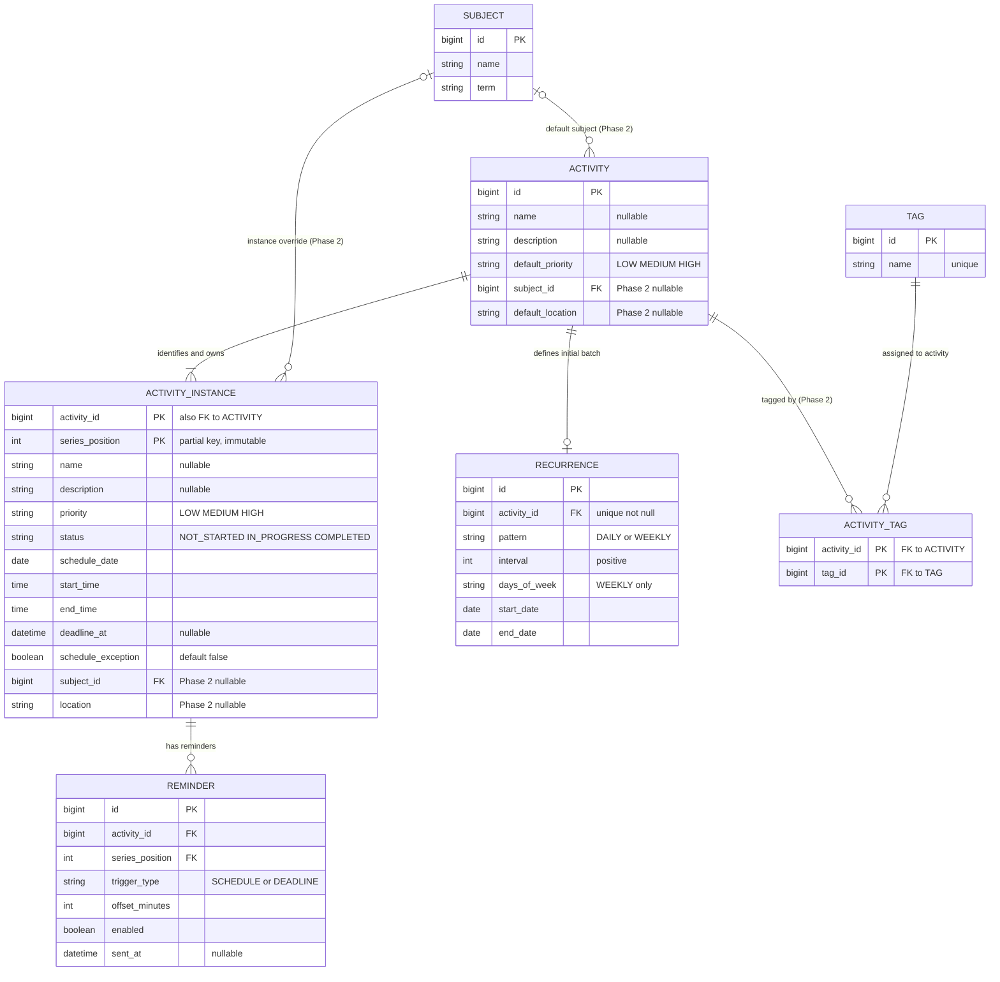

# StudyFlow — Consolidated Product & Software Specification

**Version:** 1.0 — Design baseline locked  
**Date:** 2026-10-13  
**Status:** Baseline đã chốt theo các quyết định ngày 2026-10-13; các chi tiết triển khai còn lại được ghi rõ tại từng ràng buộc kỹ thuật.

> Tài liệu này hợp nhất bối cảnh sản phẩm, User Needs, Scope, Requirements, Business Rules, Use Cases, Domain Model, ERD/Schema định hướng và kế hoạch kiểm thử của StudyFlow. Khi nội dung cũ mâu thuẫn với các quyết định mới về **Fixed Recurrence Batch** và dữ liệu riêng của **Activity Instance**, tài liệu này ưu tiên các quyết định mới nhất đã thống nhất trong quá trình thiết kế.

---

## 1. Product Overview

### 1.1. Bối cảnh và vấn đề

StudyFlow là một web application cá nhân để quản lý hoạt động học tập và các hoạt động đời sống theo lịch. Nhu cầu xuất phát từ việc kế hoạch bị phân tán giữa nhiều công cụ (ví dụ lịch, ghi chú và theo dõi cá nhân), khiến người dùng khó xem toàn bộ kế hoạch trong ngày/tuần, theo dõi tiến độ và tránh bỏ sót hoạt động.

StudyFlow hướng tới gom các hoạt động vào một nơi, cho phép người dùng xem chúng theo thời gian, đặt độ ưu tiên, deadline và reminder, theo dõi trạng thái từng lần diễn ra và quản lý các hoạt động lặp lại.

### 1.2. Product goals

- Có một nơi thống nhất để quản lý hoạt động học tập và sinh hoạt cá nhân.
- Nhìn được kế hoạch ngày/tuần và các hoạt động sắp diễn ra.
- Hạn chế bỏ sót hoạt động nhờ Schedule, Deadline và Reminder.
- Theo dõi tiến độ thông qua Status của từng lần diễn ra.
- Có trải nghiệm dễ hiểu, ổn định và dễ mở rộng.
- Là dự án học tập để thực hành Software Engineering end-to-end: requirements, use cases, domain modeling, ERD, REST API, relational database, validation, testing, Git/documentation và deployment cơ bản.

### 1.3. Target level and design principle

StudyFlow được giới hạn ở mức **beginner → lower-intermediate**. Ưu tiên một mô hình dễ hiểu, dễ kiểm thử và đáp ứng được các nhu cầu thật trước khi thêm các cơ chế phức tạp như đồng bộ recurrence động, multi-user hoặc tích hợp dịch vụ bên ngoài.

---

## 2. Terminology and Domain Vocabulary

| Term | Meaning in StudyFlow |
|---|---|
| **Activity** | Đối tượng cha/định nghĩa hoạt động. Dùng để nhóm các Activity Instance và lưu thông tin/cấu hình khởi tạo batch ban đầu. |
| **Activity Instance** | Một lần diễn ra cụ thể của Activity. Lưu dữ liệu thực tế của lần đó, có thể khác các instance cùng cha. |
| **Recurrence** | Quy tắc tạo các Activity Instance trong một khoảng thời gian hữu hạn khi tạo Activity. Với MVP, quy tắc này không dùng để tái đồng bộ hoặc sinh thêm instance sau khi batch đã tạo. |
| **Schedule** | Ngày, giờ bắt đầu và giờ kết thúc dự kiến của một Activity Instance. Mỗi instance có đúng một Schedule hợp lệ. |
| **Deadline** | Thời điểm cuối cùng để hoàn thành một Activity Instance; là tùy chọn và thuộc từng instance. |
| **Reminder** | Cấu hình nhắc cho một Activity Instance, dựa trên Schedule hoặc Deadline của chính instance đó. |
| **Priority** | Mức độ ưu tiên; có thể có giá trị mặc định ở Activity và giá trị thực tế riêng ở từng instance. |
| **Status** | Trạng thái thực tế của một Activity Instance, được quản lý độc lập. |
| **Schedule exception / schedule override** | Dấu hiệu cho biết Schedule của một instance đã được người dùng thay đổi riêng và cần được bảo vệ khỏi thao tác cập nhật Schedule hàng loạt. Không đồng nghĩa mọi thuộc tính khác cũng bị khóa. |
| **Fixed Recurrence Batch** | Tập hữu hạn các instance được tạo tại thời điểm tạo Activity lặp. Tập này không tự động mở rộng hoặc tái cấu trúc khi Recurrence thay đổi. |

**Quy tắc nền tảng:** quan hệ cha–con biểu thị nguồn gốc/nhóm quản lý, không có nghĩa mọi thay đổi của Activity tự động truyền xuống những Activity Instance đã tạo.

---

## 3. User Needs

Tài liệu Requirements hiện có dùng các mã UN01–UN07. Phần dưới đây giữ nguyên nhãn và ánh xạ đã có; mô tả được diễn đạt lại để phục vụ bản tổng hợp, không thay thế một tài liệu User Research riêng nếu tài liệu đó được bổ sung sau này.

| ID | User Need | Diễn giải nhu cầu |
|---|---|---|
| **UN01** | Nhận biết kế hoạch | Người dùng cần xem kế hoạch theo ngày/tuần và nhanh chóng nhận biết hoạt động hiện tại hoặc sắp diễn ra. |
| **UN02** | Sắp xếp hoạt động | Người dùng cần tổ chức hoạt động bằng các thuộc tính như Priority và các tiêu chí phân loại/lọc phù hợp. |
| **UN03** | Lập kế hoạch | Người dùng cần tạo hoạt động, đặt Schedule, cấu hình hoạt động lặp và thiết lập thời hạn cần thiết. |
| **UN04** | Theo dõi tiến độ | Người dùng cần cập nhật Status của từng lần diễn ra và xem tổng hợp mức độ hoàn thành. |
| **UN05** | Không bỏ sót hoạt động | Người dùng cần được nhắc vào thời điểm đã cấu hình trước Schedule hoặc Deadline. |
| **UN06** | Tính ổn định | Dữ liệu đã lưu cần giữ chính xác, nhất quán và không bị thay đổi ngoài phạm vi thao tác của người dùng; reminder cần được xử lý đúng thời điểm trong điều kiện được hỗ trợ. |
| **UN07** | Trải nghiệm sử dụng | Người dùng cần giao diện nhất quán, trực quan, dễ nhận biết kế hoạch và truy cập nhanh các thao tác thường dùng. |

### 3.1. User Need → Requirements mapping

| User Need | Requirements liên quan hiện tại |
|---|---|
| UN01 — Nhận biết kế hoạch | FR01, FR02, FR06.1, FR16, FR16.1 |
| UN02 — Sắp xếp hoạt động | FR03, FR04, FR04.1, FR06, FR06.1, FR10, FR11, FR12, FR13, FR16.1 |
| UN03 — Lập kế hoạch | FR03, FR04, FR04.1, FR05, FR07, FR09, FR09.1, FR10 |
| UN04 — Theo dõi tiến độ | FR14, FR15 |
| UN05 — Không bỏ sót hoạt động | FR07, FR08, FR08.1 |
| UN06 — Tính ổn định | NFR01, NFR02, NFR03, NFR04, NFR06 |
| UN07 — Trải nghiệm sử dụng | NFR03, NFR05 |

---

## 4. Scope

### 4.1. MVP

MVP tập trung vào quy trình quản lý hoạt động cá nhân cốt lõi:

- Tạo Activity và tạo Activity Instance tương ứng.
- Bắt buộc mỗi Activity Instance có đúng một Schedule hợp lệ.
- Tạo hoạt động không lặp hoặc tạo một Fixed Recurrence Batch với thời gian tối đa một năm.
- Xem kế hoạch ngày và tuần.
- Xem các hoạt động sắp diễn ra, sắp xếp theo Priority và cho phép đổi cách sắp xếp trong các tiêu chí hỗ trợ.
- Chỉnh sửa dữ liệu của một Activity Instance.
- Chủ động áp dụng các thuộc tính đã thay đổi cho những Activity Instance tương lai đủ điều kiện đã tồn tại trong cùng batch.
- Thiết lập Priority, Deadline và Reminder ở cấp Activity Instance.
- Nhận thông báo Reminder trong giao diện khi trang StudyFlow đang mở; không có browser push khi trang đóng trong MVP.
- Cập nhật Status độc lập từng instance.
- Xem tiến độ/thống kê hoàn thành.
- Bảo toàn dữ liệu lịch sử; không tái sinh hoặc tái cấu trúc batch sau khi tạo.

**Khuyến nghị về chỉnh sửa Activity cha trong MVP:** những chỉnh sửa có ý nghĩa với lịch nên thực hiện trên Activity Instance. Activity cha có thể giữ vai trò nhóm/định nghĩa gốc, nhưng sửa định nghĩa cha không tự cập nhật instance. Nếu giao diện cho phép sửa metadata của Activity cha sau khi tạo, cần thể hiện rõ rằng thao tác đó không đổi dữ liệu của instance hiện hữu. Không cho chỉnh Recurrence sau khi batch đã được tạo.

### 4.2. Phase 2

- Gán Subject cho Activity và/hoặc tùy chỉnh Subject theo instance.
- Thêm và quản lý Tag ở cấp Activity.
- Lọc Activity theo Tag và hiển thị instance thuộc Activity phù hợp.
- Thêm Location mặc định hoặc Location riêng theo instance.
- Bổ sung khả năng tổ chức và lọc hoạt động.

Các chức năng Phase 2 không nên bị mô tả như các trường bắt buộc của MVP trong Use Case hoặc acceptance criteria.

### 4.3. Future

- Multi-user personalization: tài khoản, authentication, authorization, phân tách dữ liệu và preferences riêng của từng người dùng.
- Đính kèm Notes, Files, Resources, Links, Questions và các dữ liệu liên quan đến Activity.
- Các tính năng mở rộng chuỗi recurrence qua nhiều batch, tích hợp lịch ngoài hoặc các tích hợp nâng cao chỉ được xem xét sau khi MVP ổn định.

### 4.4. Out of Scope của MVP

- AI-based planning/recommendations.
- Collaboration thời gian thực phức tạp.
- Thanh toán hoặc chức năng tài chính.
- Microservices/Kubernetes.
- Ứng dụng mobile riêng.
- Tích hợp dịch vụ ngoài nâng cao.
- Tự động đồng bộ Recurrence đã thay đổi bằng cách cập nhật/tạo/hủy hàng loạt instance theo quy tắc mới.

---

## 5. Functional Requirements (FR)

Câu chữ dưới đây là baseline đề xuất đã điều chỉnh theo mô hình Fixed Recurrence Batch. Các trường/Use Case đánh dấu Phase 2 chỉ có hiệu lực khi Phase 2 được triển khai.

### FR01 — Xem kế hoạch tuần
Hệ thống cho phép người dùng xem các Activity Instance được lên lịch trong một tuần, kèm Schedule của từng instance.

**Source:** UN01

### FR02 — Xem hoạt động theo ngày
Hệ thống cho phép người dùng xem các Activity Instance được lên lịch trong một ngày cụ thể theo thứ tự thời gian.

**Source:** UN01

### FR03 — Tạo Activity và Activity Instance
Hệ thống cho phép người dùng tạo Activity với Schedule hợp lệ cho instance. Nếu không lặp, hệ thống tạo một Activity Instance; nếu lặp, hệ thống tạo một Fixed Recurrence Batch trong khoảng thời gian được chọn.

**Source:** UN02, UN03

### FR04 — Chỉnh sửa định nghĩa Activity
Nếu chức năng chỉnh sửa Activity cha được cung cấp, hệ thống cho phép chỉnh sửa định nghĩa/metadata của Activity nhưng không tự động thay đổi dữ liệu của Activity Instance đã tồn tại. Việc chỉnh sửa Recurrence sau khi batch được tạo không được hỗ trợ trong MVP.

**Source:** UN02, UN03

### FR04.1 — Chỉnh sửa Activity Instance
Hệ thống cho phép người dùng chỉnh sửa dữ liệu thực tế của một Activity Instance. Với instance thuộc Fixed Recurrence Batch, người dùng có thể chọn chỉ áp dụng cho instance được chọn hoặc áp dụng các thuộc tính đã thay đổi cho instance được chọn và các instance tương lai đủ điều kiện.

**Source:** UN02, UN03

### FR05 — Thiết lập Schedule
Hệ thống cho phép người dùng đặt schedule_date, start_time và end_time trực tiếp trên Activity Instance. Ba thuộc tính bắt buộc này cấu thành Schedule; không có bảng Schedule riêng.

**Source:** UN03

### FR06 — Thiết lập Priority
Hệ thống cho phép đặt Priority mặc định trong quá trình tạo Activity và lưu Priority thực tế riêng ở từng Activity Instance. Giá trị hợp lệ: LOW, MEDIUM, HIGH.

**Source:** UN02

### FR06.1 — Sắp xếp Activity Instance theo Priority
Hệ thống cho phép người dùng xem các Activity Instance sắp diễn ra được sắp xếp theo Priority; các instance cùng Priority được sắp xếp theo Schedule.

**Source:** UN01, UN02

### FR07 — Thiết lập Deadline
Hệ thống cho phép đặt, thay đổi hoặc xóa Deadline của một Activity Instance. Deadline là tùy chọn và thuộc từng instance.

**Source:** UN03, UN05

### FR08 — Thiết lập Reminder
Hệ thống cho phép thiết lập nhiều Reminder cho một Activity Instance, dựa trên Schedule hoặc Deadline của chính instance đó; không cho phép trùng trigger_type và offset_minutes trên cùng instance.

**Source:** UN05

### FR08.1 — Thông báo Reminder
Trong MVP, khi trang StudyFlow đang mở và JavaScript đang chạy, frontend định kỳ kiểm tra các Reminder đến hạn và hiển thị thông báo trong giao diện. MVP không yêu cầu thông báo khi trang StudyFlow đã đóng và không triển khai browser push notification.

**Source:** UN05

### FR09 — Thiết lập Recurrence khi tạo
Hệ thống cho phép cấu hình Recurrence DAILY (mỗi N ngày) hoặc WEEKLY (các ngày đã chọn, mỗi N tuần). Khoảng batch không vượt quá một năm; với WEEKLY, ngày bắt đầu phải thuộc tập ngày đã chọn. Trong MVP, quy tắc Recurrence không thể dùng để tái cấu trúc batch sau khi tạo.

**Source:** UN03

### FR09.1 — Tạo Fixed Recurrence Batch
Khi Activity có Recurrence, hệ thống tạo toàn bộ Activity Instance tương ứng với các lần diễn ra trong khoảng thời gian đã chọn. Sau khi tạo thành công, hệ thống không tự động sinh thêm instance và không đồng bộ lại tập instance do thay đổi Recurrence.

**Source:** UN03

### FR10 — Thiết lập Location (Phase 2)
Hệ thống cho phép thiết lập Location mặc định cho Activity và Location riêng cho Activity Instance khi chức năng được triển khai.

**Source:** UN02, UN03

### FR11 — Gắn Tag (Phase 2)
Hệ thống cho phép gắn một hoặc nhiều Tag cho Activity khi Phase 2 được triển khai. Tag không có liên kết riêng ở cấp Activity Instance.
**Source:** UN02

### FR12 — Lọc theo Tag (Phase 2)
Hệ thống cho phép lọc Activity theo Tag và hiển thị các Activity Instance thuộc Activity phù hợp.
**Source:** UN02

### FR13 — Gán Subject (Phase 2)
Hệ thống cho phép gán Subject mặc định cho Activity và tùy chỉnh Subject riêng cho Activity Instance khi chức năng được triển khai.

**Source:** UN02

### FR14 — Cập nhật Status của Activity Instance
Hệ thống cho phép người dùng cập nhật Status của một Activity Instance thành `NOT_STARTED`, `IN_PROGRESS` hoặc `COMPLETED` mà không thay đổi instance khác. Status không tự chuyển chỉ vì Schedule đã qua.

**Source:** UN04

### FR15 — Xem trạng thái và tiến độ
Hệ thống cho phép người dùng xem trạng thái và mức độ hoàn thành của các Activity Instance trong một khoảng thời gian, bao gồm số lượng instance đã hoàn thành.

**Source:** UN04

### FR16 — Xem Activity Instance sắp diễn ra
Khi các Activity Instance được lên lịch trong ngày hiện tại đã kết thúc theo Schedule, hệ thống cho phép người dùng xem các Activity Instance sắp diễn ra.

**Source:** UN01

### FR16.1 — Sắp xếp/lọc hoạt động sắp diễn ra
Hệ thống cho phép người dùng thay đổi cách sắp xếp hoặc áp dụng bộ lọc được hỗ trợ cho các Activity Instance sắp diễn ra, bao gồm Schedule và Priority.

**Source:** UN01, UN02

### FR17 — Xóa Activity
Hệ thống cho phép người dùng xóa Activity sau khi xác nhận. Hệ thống cascade xóa Recurrence, toàn bộ Activity Instance và Reminder phụ thuộc. Việc xóa riêng một Activity Instance được quy định tại FR18.

**Source:** UN06

### FR18 — Xóa Activity Instance
Hệ thống cho phép người dùng xóa một Activity Instance sau khi xác nhận nếu Activity còn ít nhất một instance khác. Reminder của instance đó bị xóa theo; các `series_position` còn lại giữ nguyên và không tạo occurrence bù. Không được xóa riêng instance cuối cùng; người dùng phải xóa Activity cha.

**Source:** UN02, UN06

---

## 6. Non-functional Requirements (NFR)

### NFR01 — Reliability
Sau khi thao tác lưu thành công, dữ liệu phải vẫn chính xác sau khi tải lại hoặc mở lại ứng dụng.

**Initial target:** dữ liệu của thao tác đã xác nhận thành công không bị mất hoặc tự thay đổi trong những lần sử dụng tiếp theo.

### NFR02 — Data Integrity
Hệ thống phải duy trì tính nhất quán giữa Activity, Activity Instance, Schedule, Deadline, Reminder, Status và các dữ liệu Phase 2. Chỉnh sửa một instance không được tự động thay đổi các instance khác. Chỉnh sửa Activity cha không được tự động cập nhật instance đã tồn tại.

### NFR03 — Responsiveness
Giao diện phản ánh thay đổi sau khi thao tác được xử lý thành công.

**Initial target:** với thao tác thông thường trong điều kiện sử dụng dự kiến, giao diện phản ánh kết quả trong vòng 1 giây sau khi hệ thống xác nhận thành công.

### NFR04 — Reminder Timeliness
Hệ thống thông báo gần thời điểm Reminder đến hạn.

**Initial target:** hiển thị thông báo trong vòng 1 phút kể từ lúc Reminder đến hạn khi trang StudyFlow vẫn mở, trình duyệt hoạt động và frontend tiếp tục chạy. Đây không phải cam kết khi tab bị treo, trình duyệt đóng hoặc thiết bị ngủ; Reminder đã quá thời điểm xử lý sẽ bị bỏ qua, không gửi bù.

### NFR05 — Usability
Giao diện trực quan, nhất quán và dễ hiểu; kế hoạch ngày hiện tại nhìn thấy trực tiếp từ màn hình chính; Name, Schedule, Priority và Status được trình bày nhất quán; thao tác thường dùng dễ truy cập.

### NFR06 — Privacy and Security
Dữ liệu cá nhân phải được bảo vệ và không cho phép người không có quyền xem hoặc thay đổi. MVP có thể là ứng dụng cá nhân một người dùng; authentication, authorization và data isolation đầy đủ thuộc phạm vi multi-user trong tương lai, trừ khi cách triển khai MVP yêu cầu truy cập qua mạng.

---

## 7. Business Rules (BR) — Baseline đã hợp nhất

### BR01 — Subject Association (Phase 2)
Activity có thể có Subject mặc định hoặc không có Subject. Khi Phase 2 được triển khai, Subject có thể được tùy chỉnh riêng cho một Activity Instance.

### BR02 — Activity Instance Scheduling
Mỗi Activity Instance phải có đủ ba thuộc tính Schedule bắt buộc lưu trực tiếp trên row. Activity không lặp tạo một instance; Activity lặp tạo nhiều instance trong Fixed Recurrence Batch.

### BR03 — Activity–Instance Relationship
Mỗi Activity Instance thuộc đúng một Activity cha và là weak entity, định danh bằng khóa ghép (activity_id, series_position). Instance vẫn thuộc Activity cha khi các thuộc tính bị chỉnh sửa riêng; xóa Activity sẽ cascade xóa instance và Reminder phụ thuộc.

### BR04 — Instance Status
Status được quản lý riêng cho từng Activity Instance; chỉ nhận NOT_STARTED, IN_PROGRESS, COMPLETED, và không tự đổi khi Schedule đã qua.

### BR05 — Optional Deadline per Instance
Mỗi Activity Instance có thể có Deadline hoặc không. Deadline được lưu cho từng instance, không bắt buộc dùng chung một thời điểm tuyệt đối cho tất cả instance của batch.

### BR06 — Reminder per Instance
Reminder thuộc một Activity Instance và dựa trên Schedule hoặc Deadline của instance. Reminder theo Deadline yêu cầu Deadline tồn tại; khi Deadline bị xóa, Reminder loại DEADLINE bị xóa theo. Cấu hình trùng trigger_type/offset_minutes bị cấm, kể cả disabled. Reminder disabled hoặc đã quá thời điểm kích hoạt không được gửi.

### BR07 — Daily Activity Ordering
Các Activity Instance trong chế độ xem ngày được sắp xếp theo thời điểm bắt đầu Schedule.

### BR08 — Upcoming Activity Display
Trên màn hình chính, hệ thống hiển thị kế hoạch ngày hiện tại theo trình tự thời gian. Khi tất cả Schedule của những hoạt động trong ngày đã kết thúc, hệ thống chuyển trọng tâm sang các Activity Instance sắp diễn ra trong tương lai.

### BR09 — Upcoming Activity Ordering
Các Activity Instance sắp diễn ra mặc định được sắp xếp theo Priority HIGH → MEDIUM → LOW; các instance cùng Priority được sắp xếp theo thời điểm bắt đầu Schedule tăng dần. Người dùng có thể thay đổi tiêu chí sắp xếp hoặc dùng bộ lọc được hỗ trợ.

### BR10 — Recurrence Limit and Fixed Batch
Recurrence chỉ sinh các Activity Instance trong một khoảng thời gian hữu hạn, tối đa một năm tính từ ngày bắt đầu lặp. Toàn bộ instance trong khoảng đó được tạo khi Activity được lưu thành công.

### BR11 — Activity Instance Data Independence
Mỗi Activity Instance lưu dữ liệu thực tế riêng, bao gồm Status, Name, Description, Priority, ba trường Schedule, Deadline, Reminder và các thuộc tính Phase 2 khi triển khai. Thay đổi ở một instance không tự động thay đổi instance khác.

### BR12 — Activity Name Optional
Activity có thể được tạo mà không cần Name. Quy tắc này không miễn trừ yêu cầu Schedule cho từng instance.

### BR13 — Edit Instance Scope
Khi chỉnh sửa instance thuộc Fixed Recurrence Batch, hệ thống cho phép chọn chỉ áp dụng cho instance được chọn hoặc áp dụng các thuộc tính đã thay đổi cho instance được chọn và các instance tương lai đủ điều kiện. Lựa chọn bulk chỉ được cung cấp khi instance được chọn có Schedule ở tương lai và Status chưa Completed; nếu instance được chọn đã ở quá khứ hoặc đã Completed, người dùng chỉ có thể chỉnh sửa riêng instance đó.

### BR14 — Single-Instance Edit
Khi chỉ áp dụng cho instance được chọn, chỉ dữ liệu của instance đó được cập nhật. Instance tiếp tục thuộc Activity cha và giữ nguồn gốc của batch. Chỉnh sửa thuộc tính không liên quan đến Schedule không tự tạo Schedule exception.

### BR15 — Editing Activity Definition
Chỉnh sửa Activity cha không tự động thay đổi Activity Instance đã tồn tại. Giá trị định nghĩa/default được dùng để khởi tạo dữ liệu ở thời điểm tạo batch; sau đó dữ liệu instance được quản lý riêng.

### BR16 — Explicit Bulk Update
Thay đổi hàng loạt chỉ thực hiện khi người dùng chủ động chọn phạm vi áp dụng. Chỉ những thuộc tính nằm trong nội dung thay đổi mới được cập nhật; các thuộc tính khác không bị ghi đè.

### BR17 — Schedule Exception
Nếu người dùng đổi Schedule riêng cho một Activity Instance, Schedule đó được đánh dấu là ngoại lệ lịch. Thao tác cập nhật Schedule hàng loạt không ghi đè Schedule ngoại lệ. Thay đổi Name, Description, Priority, Deadline hoặc Reminder không tự tạo Schedule exception.

### BR18 — Recurrence Configuration Is Fixed After Creation
Sau khi Fixed Recurrence Batch được tạo, không cho sửa Recurrence để tạo thêm, loại bỏ hoặc tái lập lịch hàng loạt các occurrence. Muốn tạo giai đoạn tiếp theo hoặc dùng quy tắc lặp khác, người dùng tạo Activity mới.

### BR19 — Protect Past and Completed Instances
Cập nhật hàng loạt không được thay đổi những instance có thời điểm Schedule đã qua hoặc có Status là Completed. Người dùng vẫn có thể chỉnh sửa riêng một instance quá khứ nếu hệ thống cho phép thao tác đó.

### BR20 — Initialize Instance Values
Khi tạo batch, các instance được khởi tạo từ dữ liệu Activity và cấu hình Recurrence tại thời điểm tạo. Sau khi được tạo, các giá trị thực tế của instance được lưu riêng; chỉnh sửa Activity cha sau đó không làm cập nhật lại instance.

### BR21 — Schedule Conflict
Nếu Schedule mới chồng lấn với Schedule của instance khác trong cùng ngày, hệ thống cảnh báo nhưng cho phép xác nhận bỏ qua. Dùng khoảng nửa mở [start, end): start_A < end_B AND start_B < end_A.

### BR22 — Tag Association (Phase 2)
Tag chỉ gắn với Activity. Khi lọc instance theo Tag, hệ thống dùng Tag của Activity cha; không có bảng INSTANCE_TAG trong thiết kế đã chốt.

### BR23 — Bulk Update Eligibility
Một instance đủ điều kiện cập nhật hàng loạt khi Schedule của nó vẫn ở tương lai và Status chưa Completed. Instance quá khứ dù chưa hoàn thành vẫn bị bảo vệ khỏi cập nhật hàng loạt. Schedule exception chỉ bảo vệ Schedule; các thuộc tính khác có thể cập nhật nếu nằm trong phạm vi người dùng đã chọn.

### BR24 — No Automatic Recurrence Regeneration
Hệ thống không tự tạo occurrence bù hoặc tự đồng bộ batch khi người dùng sửa một thuộc tính instance. Việc chỉnh sửa instance không làm thay đổi số lượng instance đã tạo.

### BR25 — Fixed Status and Priority Values
Status chỉ nhận `NOT_STARTED`, `IN_PROGRESS`, `COMPLETED`; Priority chỉ nhận `LOW`, `MEDIUM`, `HIGH`. Status không tự đổi chỉ vì Schedule đã qua.

### BR26 — Activity Instance Identification and Cascade Delete
Activity Instance là weak entity có khóa ghép `(activity_id, series_position)`; `series_position` bất biến. Xóa Activity sẽ cascade xóa Recurrence, toàn bộ Activity Instance và Reminder phụ thuộc. Có thể xóa riêng một instance nếu Activity còn ít nhất một instance; Reminder của instance đó cascade và các vị trí còn lại không được đánh lại số. Không được xóa riêng instance cuối cùng.

### BR27 — Reminder Uniqueness and Missed Trigger
Trong cùng Activity Instance, không cho phép hai Reminder có cùng `trigger_type` và `offset_minutes`, bất kể trạng thái enabled. Nếu thời điểm trigger đã qua, hệ thống bỏ qua và không gửi bù.

### BR28 — Schedule Composite Attribute
Schedule là nhóm ba thuộc tính bắt buộc trên Activity Instance, không phải entity/bảng riêng. `end_time` phải lớn hơn `start_time`; hoạt động qua nửa đêm nằm ngoài MVP.

### BR29 — Supported Recurrence Patterns
MVP chỉ hỗ trợ DAILY (mỗi N ngày) và WEEKLY (các ngày trong tuần đã chọn, mỗi N tuần). Khoảng ngày bao gồm hai đầu mút và không quá một năm; với WEEKLY, weekday của `start_date` phải nằm trong `days_of_week`.

### BR30 — Individual Activity Instance Deletion
Người dùng có thể xóa một Activity Instance riêng lẻ sau khi xác nhận nếu Activity còn ít nhất một instance khác. Reminder phụ thuộc instance bị xóa theo; các `series_position` còn lại giữ nguyên và không tạo occurrence bù. Không được xóa instance cuối cùng riêng lẻ; phải xóa Activity cha.

---

## 8. Use Cases

**Primary actor:** User. MVP hiện là trải nghiệm cá nhân; không giả định có Admin/Operator role.

### UC01 — Create Activity / Fixed Recurrence Batch

**Goal:** Tạo một Activity và các instance ban đầu.

**Main flow:**
1. Người dùng chọn Create Activity.
2. Hệ thống hiển thị form Activity và Schedule.
3. Người dùng nhập các thông tin Activity có thể có: Name, Description, Priority và các trường thuộc Phase 2 khi được hỗ trợ.
4. Người dùng đặt Schedule cho lần diễn ra đầu tiên.
5. Với hoạt động không lặp, người dùng có thể đặt Deadline trong form. Với batch lặp, Deadline của mỗi instance mặc định NULL và có thể được thiết lập sau khi tạo.
6. Người dùng có thể cấu hình Reminder trước Schedule bằng offset tương đối; khi tạo batch, cấu hình này được tạo riêng cho mỗi instance. Reminder theo Deadline chỉ hợp lệ khi instance có Deadline.
7. Người dùng có thể chọn Recurrence và khoảng thời gian lặp không vượt một năm.
8. Hệ thống kiểm tra trường bắt buộc, khoảng thời gian, Schedule và cấu hình Reminder/Deadline.
9. Hệ thống cảnh báo khi Schedule xung đột; người dùng có thể sửa hoặc xác nhận bỏ qua.
10. Hệ thống lưu Activity, cấu hình Recurrence (nếu có), các Activity Instance (với Schedule attributes) và Reminder tương ứng trong một transaction.
11. Hệ thống thông báo tạo thành công.

**Alternatives:**
- Thiếu Schedule/giờ không hợp lệ: báo lỗi, giữ form.
- Recurrence không hợp lệ hoặc vượt quá một năm: báo lỗi, giữ form.
- Reminder theo Deadline nhưng instance không có Deadline: yêu cầu sửa cấu hình hoặc vô hiệu hóa Reminder đó.
- User hủy: không lưu Activity/instance chưa tạo.

**Postconditions:** instance được tạo có đúng một Schedule; recurrence batch là hữu hạn và không tự mở rộng sau này.

### UC02 — Edit Activity Instance

**Goal:** Chỉnh sửa dữ liệu thực tế của một occurrence mà không vô tình thay đổi instance khác.

**Main flow:**
1. Người dùng chọn Activity Instance.
2. Hệ thống hiển thị dữ liệu hiện tại.
3. Người dùng sửa một hoặc nhiều thuộc tính: Name, Description, Schedule, Priority, Deadline, Reminder và các trường Phase 2 khi được hỗ trợ.
4. Nếu instance thuộc batch, hệ thống hỏi phạm vi: “Chỉ instance này” hoặc “Instance này và các instance tương lai chưa hoàn thành”.
5. Hệ thống xác thực dữ liệu và kiểm tra Schedule conflict.
6. Nếu chỉ sửa instance này, chỉ instance được chọn được cập nhật; nếu Schedule thay đổi riêng, đánh dấu Schedule exception.
7. Nếu chọn bulk update, hệ thống cập nhật các thuộc tính đã thay đổi trên những instance tương lai đủ điều kiện, không cập nhật instance quá khứ/Completed; Schedule exception không bị ghi đè khi thuộc tính Schedule được cập nhật hàng loạt.
8. Hệ thống lưu thay đổi và phản ánh kết quả.

**Quan trọng:** UC02 không cho sửa Recurrence của batch đã tạo. Muốn có chuỗi mới hoặc mở rộng thời gian, người dùng tạo Activity mới.

**Alternatives:** dữ liệu/Schedule không hợp lệ thì không lưu; khi user hủy, dữ liệu cũ được giữ nguyên.

### UC03 — View Daily Plan

1. Người dùng mở chế độ xem ngày.
2. Hệ thống lấy các Activity Instance có Schedule trong ngày.
3. Hệ thống sắp xếp theo thời điểm bắt đầu.
4. Hệ thống hiển thị thông tin chính của từng instance.
5. Nếu không có dữ liệu, hiển thị empty state; nếu tải lỗi, hiển thị thông báo lỗi và cho phép thử lại.

### UC04 — View Weekly Plan

1. Người dùng mở chế độ xem tuần hoặc chọn tuần.
2. Hệ thống lấy các instance có Schedule trong khoảng tuần.
3. Hệ thống nhóm theo ngày và hiển thị Schedule từng instance.
4. Nếu không có dữ liệu, hiển thị empty state.

### UC05 — View Upcoming Activities

1. Khi Schedule các hoạt động trong ngày hiện tại đã kết thúc, hệ thống lấy các instance có Schedule ở tương lai.
2. Hệ thống sắp xếp mặc định theo Priority rồi Schedule.
3. Người dùng có thể đổi tiêu chí sắp xếp hoặc áp dụng bộ lọc được hỗ trợ.
4. Nếu không có kết quả, hiển thị empty state.

### UC06 — Update Activity Instance Status

1. Người dùng chọn Activity Instance.
2. Hệ thống hiển thị Status hiện tại.
3. Người dùng chọn Status mới và xác nhận.
4. Hệ thống kiểm tra và lưu Status của đúng instance đó.
5. Nếu dữ liệu không hợp lệ hoặc lưu lỗi, giữ nguyên dữ liệu cũ.

### UC07 — View Activity Progress

1. Người dùng chọn khoảng thời gian.
2. Hệ thống lấy các Activity Instance trong khoảng thời gian.
3. Hệ thống tổng hợp Status và số lượng instance đã hoàn thành.
4. Hệ thống hiển thị kết quả; xử lý empty state và lỗi tải dữ liệu.

### UC08 — Filter Activities by Tag (Phase 2)

1. Người dùng chọn Tag để lọc.
2. Hệ thống tìm Activity/Activity Instance khớp với phạm vi gắn Tag đã chọn.
3. Hệ thống hiển thị kết quả; cho phép bỏ lọc.

### UC09 — Receive Reminder Notification

1. Khi trang StudyFlow đang mở, frontend định kỳ yêu cầu backend cung cấp các Reminder cần kiểm tra.
2. Backend xác định thời điểm nhắc từ Schedule hoặc Deadline của Activity Instance liên quan và chỉ trả các Reminder đến hạn trong khoảng kiểm tra hiện tại, chưa được xử lý và không bị disabled.
3. Frontend hiển thị thông báo trong giao diện StudyFlow và ghi nhận kết quả hiển thị qua backend để tránh hiển thị lặp.
4. Reminder dựa trên Deadline không hoạt động nếu instance không có Deadline. Reminder đã quá thời điểm xử lý do trang không mở hoặc bị tạm ngưng sẽ bị bỏ qua, không gửi bù.
5. MVP không dùng tiến trình Reminder Worker độc lập và không triển khai browser push notification. Nếu trang đóng, không có quá trình kiểm tra Reminder.

---

### UC10 — Delete Activity and Cascade Dependents
Người dùng yêu cầu xóa Activity và xác nhận cảnh báo; hệ thống xóa Activity, Recurrence, tất cả Activity Instance và Reminder phụ thuộc bằng một thao tác nhất quán. Hủy xác nhận giữ nguyên dữ liệu; lỗi phải rollback. Việc xóa riêng một instance được xử lý độc lập trong UC11.

### UC11 — Delete Activity Instance
Người dùng xác nhận xóa một occurrence nếu Activity còn ít nhất hai instance. Hệ thống xóa instance và Reminder phụ thuộc, không đổi `series_position` còn lại và không tạo occurrence bù. Nếu đây là instance cuối, từ chối xóa riêng và hướng sang UC10 để xóa Activity cha.

## 9. Domain Model — Finalized Baseline

### 9.1 Core concepts and cardinalities

| Concept | Model | Rule |
|---|---|---|
| Activity | Entity | Parent/definition. Stores optional Name/Description and default Priority. One successful Activity has at least one instance. |
| Activity Instance | Weak entity | Composite PK `(activity_id, series_position)`; stores instance-specific data including Schedule attributes, Priority, Status and optional Deadline. |
| Recurrence | Configuration entity | Zero or one per Activity; only DAILY or WEEKLY; used to create a fixed batch once. |
| Schedule | Composite attribute | `schedule_date`, `start_time`, `end_time` directly on Activity Instance; no separate entity/table. |
| Reminder | Entity | Zero or more per instance; composite FK to Activity Instance; trigger based on Schedule or Deadline. |
| Subject | Phase 2 entity | Activity default; instance override only if needed. |
| Tag | Phase 2 entity | Activity only; no instance-specific Tag association. |
| Location | Phase 2 attribute | Activity default and optional instance value. |

Relationships: Activity 1:N Activity Instance (identifying); Activity 1:0..1 Recurrence; Activity Instance 1:0..N Reminder; Activity N:M Tag through ACTIVITY_TAG (Phase 2); Subject/Location are optional Phase 2 data.

### 9.2 Weak entity identity

`Activity Instance` has no independent surrogate `id`. Its PK is `(activity_id, series_position)`; `activity_id` is also an FK to Activity and `series_position` is the immutable partial key. A one-time activity has position 1; a recurring batch is numbered 1..N by occurrence date. Delete behavior is explicitly implemented with `ON DELETE CASCADE`; weak-entity modeling alone does not configure database deletes.

### 9.3 Fixed Recurrence Batch

- DAILY: every N days.
- WEEKLY: on selected weekday(s), every N weeks.
- Start and end dates are inclusive, and the batch span is at most one year.
- For WEEKLY, the start date must be among selected weekdays; the date entered in the first Schedule is therefore the first occurrence.
- `start_time`/`end_time` from the creation form are copied to each occurrence; `schedule_date` is generated by Recurrence.
- The entire batch is created in one transaction. The Recurrence rule cannot later add, remove, regenerate or extend the batch. Create a new Activity for a new period/pattern.

### 9.4 Schedule, conflict and bulk update

Schedule is three mandatory columns directly on Activity Instance. `end_time > start_time`; overnight activities are not in MVP. Conflict uses half-open intervals `[start, end)`, with `start_A < end_B AND start_B < end_A`; touching at an endpoint does not count as overlap. Conflicts warn, and the user may confirm override.

`schedule_exception` defaults FALSE. Individual change of any Schedule component sets it TRUE. Bulk Schedule edit only synchronizes start/end times, preserves each date and does not overwrite exception instances. Bulk edit otherwise updates only changed attributes on existing instances with `series_position >= selected position`, future Schedule and Status not Completed. Past/Completed instances are protected; bulk edit never creates/deletes instances.

### 9.5 Status and Priority

`Status ∈ {NOT_STARTED, IN_PROGRESS, COMPLETED}`; status is changed by the user and does not automatically change merely because Schedule has passed. `Priority ∈ {LOW, MEDIUM, HIGH}`. Day view sorts by Schedule start time. Upcoming view defaults to Priority HIGH → MEDIUM → LOW, then Schedule start time ascending.

### 9.6 Deadline and Reminder

Deadline is nullable at instance level; generated recurring instances have Deadline NULL by default. Reminder supports `SCHEDULE` or `DEADLINE`, `offset_minutes >= 0`, and enabled/disabled state. One instance may have many reminders, but `(instance, trigger_type, offset_minutes)` must be unique, including disabled rows. Deadline-based Reminder requires a Deadline; deleting the Deadline deletes its DEADLINE reminders. The trigger time is computed from the instance's current Schedule/Deadline minus offset. Past-due triggers are skipped, never sent retroactively. A `sent_at` field records successful delivery to prevent repeat sending.

### 9.7 Deletion and private deployment

Deleting Activity cascades to Recurrence, all Activity Instances and dependent Reminders; ACTIVITY_TAG cascades in Phase 2. An individual instance may also be deleted when at least one sibling instance remains; its Reminders cascade, remaining positions are not renumbered, and no replacement occurrence is generated. The last remaining instance cannot be deleted independently. MVP is for private single-user use; before public deployment, access control/security protections must be implemented and verified.

## 10. ERD — Conceptual



**Notation note:** In a Chen ERD, draw Activity Instance as a weak entity (double rectangle) and Activity → Activity Instance as an identifying relationship (double diamond). The Mermaid drawing shows crow's-foot relationships and the composite key labels; Schedule is deliberately not a separate entity.

## 11. Relational Schema — Proposed Baseline

### ACTIVITY

```text
ACTIVITY(id PK, name NULL, description NULL,
         default_priority NOT NULL CHECK IN (LOW, MEDIUM, HIGH),
         subject_id FK NULL [Phase 2], default_location NULL [Phase 2])
```

### RECURRENCE

```text
RECURRENCE(id PK, activity_id FK UNIQUE NOT NULL ON DELETE CASCADE,
           pattern CHECK IN (DAILY, WEEKLY), interval > 0,
           days_of_week [required for WEEKLY, NULL for DAILY],
           start_date NOT NULL, end_date NOT NULL)
```

`end_date >= start_date`; the inclusive period may not exceed one year. For WEEKLY, `days_of_week` must include the weekday of `start_date`. The physical representation of the weekday set will be chosen with the database dialect; behavior/validation is fixed by the rules above.

### ACTIVITY_INSTANCE — weak entity

```text
ACTIVITY_INSTANCE(
  activity_id PK/FK -> ACTIVITY.id ON DELETE CASCADE,
  series_position PK NOT NULL,
  name NULL, description NULL,
  priority NOT NULL CHECK IN (LOW, MEDIUM, HIGH),
  status NOT NULL CHECK IN (NOT_STARTED, IN_PROGRESS, COMPLETED),
  schedule_date NOT NULL, start_time NOT NULL, end_time NOT NULL,
  deadline_at NULL,
  schedule_exception NOT NULL DEFAULT FALSE,
  subject_id FK NULL [Phase 2], location NULL [Phase 2])
```

The composite primary key `(activity_id, series_position)` replaces the former surrogate `id`. The three Schedule columns are directly in this table; `CHECK (end_time > start_time)`. A successfully persisted Activity has at least one instance, enforced through a transaction/service rule.

### REMINDER

```text
REMINDER(
  id PK, activity_id FK NOT NULL, series_position FK NOT NULL,
  trigger_type CHECK IN (SCHEDULE, DEADLINE),
  offset_minutes CHECK (offset_minutes >= 0),
  enabled NOT NULL DEFAULT TRUE, sent_at NULL,
  FK (activity_id, series_position) -> ACTIVITY_INSTANCE
      ON DELETE CASCADE,
  UNIQUE (activity_id, series_position, trigger_type, offset_minutes))
```

Cross-table validation requires Deadline for `trigger_type = DEADLINE`; implement in service validation or a DB trigger. Removing Deadline removes DEADLINE Reminder rows. A successful send sets `sent_at`; expired trigger times are skipped.

### Phase 2 tables

- `SUBJECT(id PK, name NOT NULL, term NULL)`.
- `TAG(id PK, name UNIQUE NOT NULL)`.
- `ACTIVITY_TAG(activity_id PK/FK, tag_id PK/FK)`, both FKs cascade. No `INSTANCE_TAG` table.

### Schema integrity constraints

- `ACTIVITY_INSTANCE` Schedule columns are `NOT NULL`; no SCHEDULE table or SCHEDULE FK exists.
- `(activity_id, series_position)` is the instance PK; `series_position` is immutable.
- Deleting Activity cascades Recurrence and instances; deleting an instance cascades dependent Reminder.
- Duplicate Reminder configuration is forbidden for the same instance/type/offset even when disabled.
- All creation of a batch is atomic; no partially-created Activity should remain after failure.
- Schedule conflicts are warnings with confirm-to-override behavior.

## 12. Validation and Data Integrity Rules

### 12.1. Create

- Không tạo Activity/Activity Instance nếu thiếu Schedule hợp lệ.
- Recurrence start/end hợp lệ; khoảng thời gian không vượt một năm tính từ ngày bắt đầu.
- Ngày của các instance sinh theo Recurrence; start/end time từ form được sao chép vào hai trường thời gian của từng instance; ngày được sinh theo Recurrence.
- Deadline mặc định NULL trên các instance được sinh trong batch lặp. Với hoạt động không lặp, người dùng có thể đặt Deadline trước khi lưu.
- Reminder dựa trên Schedule có thể được tạo riêng cho mọi instance trong batch với cùng offset tương đối. Reminder dựa trên Deadline chỉ hợp lệ nếu instance tương ứng có Deadline.
- Tạo Activity, instance, Schedule và Reminder liên quan trong một transaction hoặc cơ chế bảo đảm không lưu dữ liệu dở dang.
- Schedule conflict được cảnh báo; người dùng có thể sửa hoặc xác nhận bỏ qua.

### 12.2. Edit one instance

- Chỉ cập nhật instance được chọn.
- Nếu Schedule của instance được đổi riêng, đặt `schedule_exception = true`.
- Kiểm tra Schedule conflict và tính nhất quán giữa Deadline/Reminder.
- Nếu lưu thất bại, dữ liệu cũ được giữ nguyên.

### 12.3. Bulk edit

- Bulk edit chỉ chạy theo lựa chọn chủ động của người dùng.
- Lựa chọn “instance này và các instance sau” dựa trên `series_position` bất biến.
- Chỉ xét instance có Schedule ở tương lai và Status chưa Completed; instance quá khứ hoặc đã Completed không được cập nhật hàng loạt.
- Chỉ các thuộc tính nằm trong thay đổi mới được cập nhật.
- Bulk Schedule edit chỉ thay đổi start/end time và giữ nguyên ngày; instance có `schedule_exception = true` giữ nguyên Schedule. Đổi ngày là chỉnh sửa riêng và tạo Schedule exception.
- Không tạo thêm, xóa hoặc tái tạo instance do bulk edit.

### 12.4. Reminder and progress

- Reminder disabled không được gửi.
- Reminder theo Deadline yêu cầu `deadline_at IS NOT NULL`.
- Khi Schedule hoặc Deadline đổi, tính lại trigger time từ dữ liệu hiện tại của instance.
- Progress tổng hợp Status từ các Activity Instance trong khoảng thời gian được chọn. Tập giá trị Status đã chốt: NOT_STARTED, IN_PROGRESS, COMPLETED.


---

## 13. Traceability: User Need → FR/NFR → Use Case → Domain

| User Need | FR/NFR chính | Use Cases | Domain / data |
|---|---|---|---|
| UN01 — Nhận biết kế hoạch | FR01, FR02, FR16, FR16.1; NFR05 | UC03, UC04, UC05 | Activity Instance, Schedule, Priority |
| UN02 — Sắp xếp hoạt động | FR03, FR04.1, FR06, FR06.1; Phase 2: FR10–FR13 | UC01, UC02, UC05, UC08 | Activity, Activity Instance, Priority, Tag/Subject/Location (Phase 2) |
| UN03 — Lập kế hoạch | FR03–FR05, FR07, FR09, FR09.1 | UC01, UC02 | Activity, Recurrence, Activity Instance, Schedule, Deadline |
| UN04 — Theo dõi tiến độ | FR14, FR15; NFR02 | UC06, UC07 | Activity Instance.Status |
| UN05 — Không bỏ sót hoạt động | FR07, FR08, FR08.1; NFR04 | UC01, UC02, UC09 | Activity Instance.Deadline, Schedule, Reminder |
| UN02 — Sắp xếp hoạt động | FR18 | UC11 | Activity Instance composite identity, Reminder dependency |
| UN06 — Tính ổn định | FR17, FR18; NFR01, NFR02, NFR03, NFR04, NFR06 | UC10, UC11 and all core use cases | Database constraints, cascade delete, transactions, validation, error handling |
| UN07 — Trải nghiệm sử dụng | NFR03, NFR05 | UC01–UC11 where applicable | UI flow, clear labels, responsive feedback |

---

## 14. Test Plan — Key Scenarios

### Create and recurrence batch

1. Tạo Activity không lặp với Schedule hợp lệ → có đúng một instance và một Schedule.
2. Tạo Activity lặp trong phạm vi hợp lệ → tạo đúng số instance theo pattern/end date.
3. Recurrence vượt quá một năm → từ chối lưu và giữ dữ liệu form.
4. Thiếu Schedule → không tạo Activity/instance.
5. Reminder theo Deadline nhưng không có Deadline → validation báo lỗi hoặc yêu cầu tắt cấu hình.
6. Schedule giao nhau với instance khác → cảnh báo; cho tiếp tục khi người dùng xác nhận.
7. Tạo batch thành công rồi chỉnh Activity cha → các instance đã tồn tại không thay đổi.
8. Batch đã tạo → không cho chỉnh Recurrence để tái sinh hoặc kéo dài batch.

### Instance edits

9. Sửa Name một instance → chỉ instance đó đổi.
10. Sửa Priority một instance → Status và dữ liệu instance khác giữ nguyên.
11. Sửa Schedule riêng → `schedule_exception = true`.
12. Sửa Deadline/xóa Deadline → xử lý Reminder dựa trên Deadline một cách hợp lệ.
13. Sửa Reminder → chỉ ảnh hưởng instance tương ứng.
14. Dữ liệu/Schedule không hợp lệ → không lưu và giữ dữ liệu cũ.

### Bulk edit

15. Bulk edit Priority → chỉ các instance tương lai chưa hoàn thành đủ điều kiện được cập nhật.
16. Instance đã hoàn thành ở tương lai → giữ nguyên.
17. Instance chưa hoàn thành nhưng Schedule đã qua → giữ nguyên.
18. Instance có Schedule exception khi bulk edit Priority → Priority có thể cập nhật; Schedule giữ nguyên.
19. Instance có Schedule exception khi bulk edit Schedule → Schedule giữ nguyên.
20. Bulk edit không tạo thêm hoặc xóa instance.
21. Thuộc tính không nằm trong phạm vi thay đổi không bị ghi đè.
22. Nếu một phần validation của bulk edit thất bại theo chính sách giao dịch đã chọn → không để dữ liệu bị cập nhật dở dang.

### Views, status, reminders

23. Daily plan → theo thời gian Schedule.
24. Weekly plan → các instance nhóm theo ngày.
25. Upcoming list → sắp theo Priority, rồi Schedule.
26. Cập nhật Status một instance → tiến độ phản ánh đúng, không đổi Status instance khác.
27. Reminder disabled → không gửi.
28. Reminder đến hạn → thông báo trong mục tiêu NFR04 khi môi trường hỗ trợ.
29. Không có dữ liệu trong một view → empty state, không phải lỗi.
30. Lỗi tải dữ liệu → thông báo rõ, không làm mất dữ liệu đã lưu.
31. Xóa Activity → Recurrence, tất cả Activity Instance và Reminder liên quan bị xóa theo; dữ liệu ngoài Activity không bị ảnh hưởng.
32. Hủy xóa Activity → giữ nguyên Activity và tất cả dữ liệu phụ thuộc.
33. Xóa một instance khi Activity còn ít nhất hai instance → chỉ instance chọn và Reminder của nó bị xóa; không đánh lại số các instance còn lại.
34. Cố xóa instance cuối cùng riêng lẻ → từ chối và hướng sang xóa Activity cha.

---

## 15. Đối chiếu tham khảo với Calendar apps

StudyFlow không cần sao chép toàn bộ độ linh hoạt của ứng dụng lịch lớn. Google Calendar hỗ trợ cấu hình điểm kết thúc của sự kiện lặp và lựa chọn phạm vi áp dụng thay đổi đối với các sự kiện lặp; Apple Calendar cũng cho cấu hình End Repeat và thao tác xóa một occurrence hoặc các occurrence tương lai.

Tài liệu tham khảo chính thức:

- Google Calendar Help — [Create a recurring event](https://support.google.com/calendar/answer/37115?hl=en)
- Apple Support — [Set up or delete a repeating event in Calendar on Mac](https://support.apple.com/guide/calendar/set-up-or-delete-a-repeating-event-icl1018/mac)

StudyFlow chọn mô hình hữu hạn và ít tự động hóa hơn để giảm độ phức tạp của đồng bộ, bảo toàn dữ liệu và kiểm thử. Đây là lựa chọn phạm vi của dự án, không phải tuyên bố rằng mô hình batch cố định là mô hình phổ biến nhất hoặc đúng cho mọi ứng dụng lịch.

---

## 16. Finalized Decisions and Implementation Notes

### Decisions now treated as the baseline

- Deadline is optional and stored on each Activity Instance, not on Activity.
- Reminder is linked to Activity Instance and may use that instance’s Schedule or Deadline.
- Recurrence creates a Fixed Recurrence Batch once at Activity creation; it is immutable after creation and does not create/delete/regenerate later instances. A new time period or recurrence pattern requires a new Activity.
- Bulk edit is explicit, limited to existing later instances that are still in the future and not Completed. Past and Completed instances are protected.
- `series_position` is immutable and determines the stable order within a batch; it is assigned 1 for a one-time instance and 1..N for recurring instances.
- For a bulk Schedule edit in MVP, update start/end times while keeping each instance’s date. Moving an instance to a different date is a single-instance edit and creates a Schedule exception.
- An Activity-parent edit does not propagate to existing instances and cannot change Recurrence after batch creation.
- For a recurring batch, Deadline defaults to NULL for each generated instance. A Schedule-based Reminder configured during creation may be instantiated separately for each instance with the same relative offset. A Deadline-based Reminder requires a Deadline on the specific instance.

### Implementation notes (not open product decisions)

1. Status đã chốt: NOT_STARTED, IN_PROGRESS, COMPLETED.
2. Priority đã chốt: LOW, MEDIUM, HIGH.
3. Tag Phase 2 chỉ gắn với Activity; không có INSTANCE_TAG.
4. Schedule là composite attribute gồm schedule_date, start_time, end_time trên Activity Instance; không có bảng SCHEDULE.
5. Activity Instance là weak entity với PK ghép (activity_id, series_position).
6. Recurrence chỉ DAILY/WEEKLY; fixed batch tối đa một năm.
7. MVP dùng riêng tư; public deployment phải có access/security controls trước khi mở công khai.
8. Các quyết định nghiệp vụ chính đã chốt. Chi tiết còn lại là chi tiết DDL theo database dialect (ví dụ cách biểu diễn tập days_of_week), cách triển khai thông báo và xác thực ràng buộc liên bảng.

---

## 17. Recommended Next Steps

Technical architecture, provisional stack and suggested source-code structure are documented in `architecture.md`. The reminder delivery decision is fixed for MVP: in-app reminders are checked by the frontend while the StudyFlow page is open; browser push and a dedicated background worker are deferred.

1. Vẽ lại ERD trong công cụ của bạn theo mục 10: Activity Instance là weak entity với khóa ghép và Schedule là thuộc tính tổng hợp.
2. Viết DDL theo schema mục 11; xác định biểu diễn vật lý của `days_of_week` khi chốt database dialect.
3. Triển khai theo thứ tự: Activity/Instance CRUD, individual delete and cascade delete → Schedule validation/conflict → recurrence batch → Reminder → status/progress → views.
4. Dùng test cases mục 14 để kiểm tra traceability giữa requirements, business rules và implementation.
5. Thiết kế API cho việc frontend kiểm tra Reminder định kỳ và xác nhận đã hiển thị; không xây dựng Reminder Worker hay browser push trong MVP.

**Nguyên tắc xuyên suốt:** nghiệp vụ đã thống nhất quyết định thiết kế dữ liệu; ERD/Schema không được tự ý thay đổi cách StudyFlow hoạt động.
