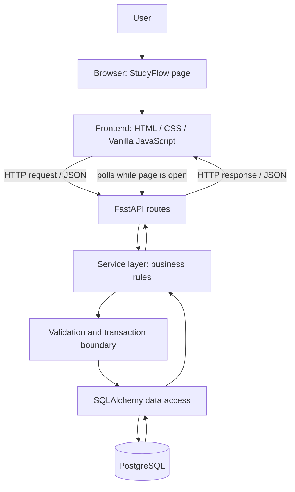

# StudyFlow — Technical Architecture & Project Structure

**Status:** Proposed technical design; technology stack remains a proposal until the user explicitly confirms it.
**Scope:** Private, single-user MVP. Domain rules follow `StudyFlow_Consolidated_Specification.md`.

## 1. Proposed technology stack

| Layer | Proposed technology | Why it fits this project |
|---|---|---|
| Frontend | HTML, CSS, Vanilla JavaScript | Starts from current skills and avoids framework overhead early on. |
| Backend API | Python + FastAPI | Uses Python, supports typed request/response models, and exposes HTTP endpoints. |
| Relational database | PostgreSQL | Supports relational constraints, composite foreign keys, transactions, and checks. |
| Database access | SQLAlchemy | Lets Python work with the database while retaining SQL/database concepts. |
| Schema migrations | Alembic, introduced when the initial schema exists | Records controlled database schema changes. It does not need to be mastered before writing the first schema. |

The stack is a working proposal rather than a final technology decision. It can change without changing the agreed domain model, as long as the implementation preserves its business rules and relational constraints.

## 2. Logical architecture



### Responsibilities

- **Frontend:** renders day/week views and forms, collects user input, calls the API, shows success/error feedback, and displays due Reminder notifications in the StudyFlow interface.
- **API routes:** translate HTTP requests into service calls and return appropriate responses. Routes should not contain complicated recurrence or bulk-edit logic.
- **Service layer:** implements domain rules: creating a fixed batch, assigning stable `series_position`, individual/bulk edits, schedule-conflict checks, Reminder eligibility, and delete rules.
- **Validation:** validates payload shape and field-level rules; service/database enforce cross-field and cross-row rules that a single field validator cannot guarantee.
- **Data access:** SQLAlchemy models/queries access PostgreSQL.
- **PostgreSQL:** is the source of truth for saved data, primary/foreign keys, unique constraints, checks, and transaction integrity.

## 3. Reminder behavior in MVP

MVP supports in-app reminders only while the StudyFlow page is open and the frontend is running. It does not include browser push, service-worker push, or a separate background Reminder Worker.

Suggested first implementation:

1. The frontend polls a Reminder API periodically (for example, every 30 seconds) while the StudyFlow page is open.
2. The API calculates trigger time from the instance's current Schedule or Deadline and returns only enabled, valid reminders that fall inside the current polling window and have not been acknowledged as displayed.
3. The frontend displays an in-app notification.
4. The frontend acknowledges the displayed Reminder using the API; the backend records `sent_at` (meaning displayed to the user in this MVP).
5. A trigger missed while the page is closed/suspended is skipped rather than displayed retroactively.

A polling interval is a target, not an exact timer: browsers can throttle background tabs, and operating-system sleep can suspend JavaScript. The NFR target of within one minute only applies when the page is active enough for polling to run. If a more reliable notification is later required, evaluate browser push or backend-driven delivery as a separate enhancement.

## 4. Suggested project directory structure

Use a small structure that separates responsibilities without creating a package for every small concept prematurely:

```text
studyflow/
├── frontend/
│   ├── index.html
│   ├── css/
│   │   └── styles.css
│   └── js/
│       ├── main.js             # frontend entry point / page initialization
│       ├── api.js              # fetch calls to backend API
│       ├── reminders.js        # polling and in-app reminder display
│       ├── activity-form.js    # create/edit form behavior
│       └── views/
│           ├── day-view.js
│           ├── week-view.js
│           └── upcoming-view.js
├── backend/
│   ├── app/
│   │   ├── main.py             # FastAPI application entry point
│   │   ├── api/
│   │   │   └── routes/
│   │   │       ├── activities.py
│   │   │       ├── instances.py
│   │   │       ├── reminders.py
│   │   │       └── progress.py
│   │   ├── schemas/            # request/response models
│   │   ├── models/             # SQLAlchemy ORM models
│   │   ├── services/           # business rules
│   │   ├── db/                 # session and database setup
│   │   └── core/               # configuration
│   └── tests/
├── migrations/                 # Alembic files, added during DB setup
├── docs/
│   ├── requirements.md
│   ├── user-case.md
│   ├── domain_model.md
│   ├── schema.md
│   └── architecture.md
├── .env.example
├── .gitignore
└── README.md
```

This is a proposed starting point, not a demand to create every file on day one. Create folders and files when their responsibility becomes necessary. For an easy local-development setup, FastAPI can serve the static frontend from the same origin initially; frontend hosting can be separated later if needed.

## 5. Key design rules to preserve

- `Activity Instance` remains a weak entity with composite primary key `(activity_id, series_position)`.
- Schedule remains three required fields on Activity Instance: `schedule_date`, `start_time`, and `end_time`; no Schedule table.
- The recurrence batch is generated once at creation and is not regenerated later.
- Create batch and dependent Reminder configuration atomically.
- Bulk edits are explicit and preserve past/Completed instances and Schedule exceptions for Schedule changes.
- Reminder uniqueness is based on `(activity_id, series_position, trigger_type, offset_minutes)`.
- Reminder-by-Deadline is only valid while that instance has a Deadline.
- Delete Activity cascades to Recurrence, instances, and dependent Reminder records; an individual instance can be removed only if at least one instance remains under its Activity.
- The MVP stays private; do not expose it publicly before adding appropriate access/security controls.

## 6. Implementation order

1. **Environment & skeleton:** repository, Python virtual environment, FastAPI starter, PostgreSQL connection settings, static frontend shell.
2. **Schema:** translate `schema.md` into SQL/database tables, constraints, and initial Alembic migration (or a single initial SQL script before introducing migrations).
3. **Core API:** create/read Activity and Activity Instance; handle composite keys and cascade rules.
4. **Schedule rules:** validation, overlap warning and user confirmation.
5. **Recurrence:** `DAILY`/`WEEKLY` generation in one transaction.
6. **Edit rules:** individual updates and explicit bulk updates.
7. **Reminder polling:** due-query endpoint, in-app frontend notification, acknowledgement, and missed-trigger tests.
8. **Status/progress and day/week views.**
9. **Error handling, test coverage, documentation, backup, and private deployment checks.**

## 7. Concepts to learn just before using them

- **Vanilla JavaScript:** DOM, event listeners, form handling, modules, `fetch`, JSON, `async/await`.
- **HTTP/REST:** method, path, request body, response body, status codes, client/server responsibilities.
- **FastAPI:** route functions, Pydantic request/response schemas, dependency injection only when needed.
- **SQLAlchemy:** model mapping, queries, transactions, and composite foreign keys.
- **Alembic migrations:** initial revision, upgrade, and how to safely record later schema changes.
- **Frontend polling:** periodically making a request while a page is open; why background-tab throttling means it cannot guarantee delivery while the page is closed or suspended.

Learn each topic immediately before using it in a StudyFlow feature rather than trying to master the entire stack up front.
