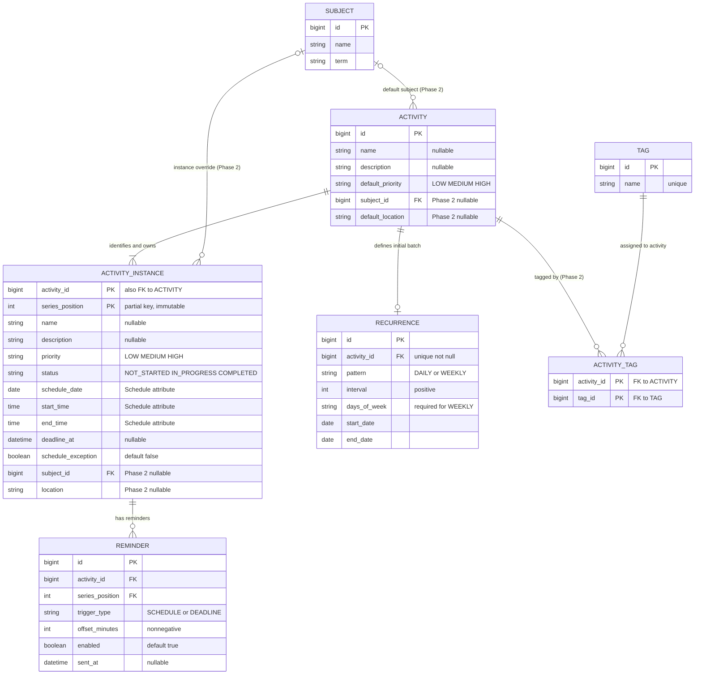

# Domain Model — StudyFlow

**Baseline:** chốt theo quyết định ngày 2026-10-13.

## 1. Core concepts

| Concept | Kind | Responsibility / rules |
|---|---|---|
| `Activity` | Entity | Đối tượng cha/định nghĩa, nhóm một hoặc nhiều Activity Instance; lưu Name/Description mặc định và Priority mặc định. Chỉnh sửa Activity không cập nhật các instance đã tạo. |
| `Activity Instance` | **Weak entity** | Một lần diễn ra cụ thể. Định danh bằng khóa ghép `(activity_id, series_position)`. Lưu dữ liệu thực tế độc lập, bao gồm Schedule, Priority, Status, Deadline và các Reminder liên quan. |
| `Recurrence` | Entity/configuration | Cấu hình bất biến được dùng đúng một lần khi tạo batch. MVP chỉ hỗ trợ `DAILY` và `WEEKLY`; khoảng tạo instance tối đa một năm. |
| `Schedule` | **Composite attribute** của Activity Instance | Gồm `schedule_date`, `start_time`, `end_time`. Không phải entity/bảng riêng trong ERD hoặc schema MVP. |
| `Deadline` | Attribute của Activity Instance | Thời điểm hoàn thành cuối cùng; có thể NULL và được quản lý riêng theo từng instance. |
| `Reminder` | Entity | Một cấu hình nhắc dựa trên Schedule hoặc Deadline của một Activity Instance. Một instance có thể có nhiều Reminder, nhưng không có cấu hình trùng loại và offset. |
| `Priority` | Attribute | `LOW`, `MEDIUM`, `HIGH`. Activity lưu mặc định; instance lưu giá trị thực tế. Thứ tự hiển thị mặc định: `HIGH`, `MEDIUM`, `LOW`. |
| `Status` | Attribute của Activity Instance | Chỉ nhận `NOT_STARTED`, `IN_PROGRESS`, `COMPLETED`. Không tự chuyển trạng thái chỉ vì Schedule đã qua. |
| `Subject` | Phase 2 entity | Subject mặc định ở Activity; có thể có giá trị riêng trên instance nếu triển khai override. |
| `Tag` | Phase 2 entity | Chỉ gắn Tag với Activity trong thiết kế Phase 2 hiện tại. Lọc các instance thông qua Tag của Activity cha; không có Tag override riêng cho instance. |
| `Location` | Phase 2 attribute | Location mặc định tại Activity và/hoặc giá trị thực tế riêng tại instance khi triển khai. |

## 2. Relationships and cardinalities

| Relationship | Cardinality | Rule |
|---|---|---|
| Activity → Activity Instance | 1:N, identifying | Mỗi Activity được tạo thành công có ít nhất một instance. `Activity Instance` là weak entity; khóa của Activity tham gia khóa định danh instance. |
| Activity → Recurrence | 1:0..1 | Activity không lặp không có Recurrence; Activity lặp có một cấu hình được giữ lại để ghi nhận batch đã tạo. |
| Activity Instance → Reminder | 1:0..N | Mỗi Reminder thuộc đúng một instance bằng khóa ngoại ghép `(activity_id, series_position)`. |
| Activity → Subject | 0..1:N (Phase 2) | Activity có thể không có Subject mặc định. |
| Activity ↔ Tag | N:M (Phase 2) | Qua `ACTIVITY_TAG`; đây là phạm vi Tag duy nhất trong bản thiết kế hiện tại. |
| Activity Instance → Subject | 0..1 (Phase 2) | Chỉ cần nếu cho phép override Subject theo instance. |

**Không có quan hệ Activity Instance → Schedule trong ERD**, vì Schedule không còn là entity riêng. Ba thuộc tính lịch nằm trực tiếp trên Activity Instance và đều bắt buộc.

## 3. Important modeling rules

### 3.1 Activity Instance as a weak entity

`Activity Instance` không có surrogate `id`. Khóa chính là `(activity_id, series_position)`, trong đó `activity_id` vừa là FK đến Activity vừa là một phần PK; `series_position` là partial key, duy nhất trong phạm vi Activity và bất biến sau khi tạo batch. Với hoạt động không lặp, `series_position = 1`; batch lặp được đánh số `1..N` theo thứ tự occurrence.

Khi xóa Activity, các Activity Instance phụ thuộc sẽ bị xóa theo. Các bảng phụ thuộc instance như Reminder cũng phải cascade theo khóa ngoại ghép. Nếu xóa riêng một instance, không đánh lại `series_position` của các instance còn lại; khoảng trống trong dãy vị trí được chấp nhận và không tạo occurrence bù. Weak entity biểu thị sự phụ thuộc định danh; hành vi xóa vẫn phải được cấu hình rõ trong database.

### 3.2 Schedule as a composite attribute

Schedule gồm `schedule_date DATE NOT NULL`, `start_time TIME NOT NULL` và `end_time TIME NOT NULL`. Trong MVP, hoạt động qua nửa đêm không được hỗ trợ; `end_time` phải lớn hơn `start_time`. Lịch được kiểm tra trùng bằng khoảng thời gian nửa mở `[start, end)`, do đó hai hoạt động nối tiếp đúng tại mốc kết thúc không chồng lấn.

### 3.3 Fixed Recurrence Batch

Recurrence chỉ hỗ trợ:

- `DAILY`: tạo theo mỗi `interval` ngày.
- `WEEKLY`: tạo vào một hoặc nhiều ngày trong tuần đã chọn; `interval` xác định mỗi N tuần.

`start_date` và `end_date` là hai đầu mút bao gồm; khoảng batch không vượt quá một năm. Với WEEKLY, ngày `start_date` phải thuộc tập `days_of_week`, để ngày nhập trên Schedule ban đầu chính là occurrence đầu tiên. Mỗi occurrence tạo một Activity Instance với `series_position` tăng dần theo ngày. `start_time` và `end_time` từ form được sao chép cho mỗi occurrence; `schedule_date` được lấy từ Recurrence.

Toàn bộ batch được tạo trong cùng thao tác lưu. Sau khi tạo, không sửa Recurrence để tái tạo, thêm hoặc xóa occurrence; để dùng kỳ hoặc quy tắc mới, tạo Activity mới. Batch không tự mở rộng.

### 3.4 Independent instance values and editing

Name, Description, Priority, Status, Schedule và Deadline là giá trị thực tế của từng instance. Giá trị ban đầu được sao chép từ form/default của Activity khi tạo; chỉnh sửa Activity cha về sau không lan xuống các instance hiện có.

Bulk edit chỉ tác động các instance đã tồn tại có `series_position` bằng hoặc lớn hơn instance được chọn, Schedule đang ở tương lai và Status chưa Completed. Instance quá khứ hoặc Completed luôn bị bỏ qua. Chỉ cập nhật các thuộc tính được thay đổi rõ ràng; không tạo, xóa hoặc tái sinh instance.

### 3.5 Schedule exception

`schedule_exception BOOLEAN NOT NULL DEFAULT FALSE` đánh dấu Schedule đã được thay đổi riêng ở instance. Khi sửa riêng bất kỳ thành phần Schedule nào, đặt cờ thành TRUE. Bulk Schedule edit chỉ đồng bộ `start_time`/`end_time`, giữ nguyên `schedule_date` và bỏ qua Schedule của instance có cờ TRUE. Cờ này không chặn bulk update các thuộc tính khác.

### 3.6 Status and Priority

- `status ∈ {NOT_STARTED, IN_PROGRESS, COMPLETED}`.
- `priority ∈ {LOW, MEDIUM, HIGH}`.
- Không tự động đổi Status chỉ vì Schedule đã kết thúc.
- Danh sách ngày sắp theo thời gian bắt đầu tăng dần. Danh sách sắp tới mặc định sắp theo Priority giảm dần (`HIGH` trước), rồi Schedule tăng dần.

### 3.7 Deadline and Reminder

Deadline là nullable và thuộc instance. Với batch lặp, Deadline của từng instance mặc định NULL; người dùng có thể thêm sau.

Reminder có `trigger_type = SCHEDULE | DEADLINE`, `offset_minutes >= 0`, `enabled` và thời điểm gửi tính từ Schedule/Deadline của chính instance. Reminder dựa trên Deadline chỉ tồn tại khi instance có Deadline. Khi Deadline bị xóa, các Reminder loại DEADLINE của instance đó bị xóa theo. Cùng một instance không được có hai Reminder trùng `(trigger_type, offset_minutes)`, kể cả khi một cấu hình đang disabled; hai loại trigger khác nhau vẫn có thể dùng cùng offset.

Khi tạo batch, Reminder theo Schedule được tạo riêng cho mỗi instance với offset đã chọn. Trong MVP, frontend kiểm tra Reminder định kỳ khi trang StudyFlow đang mở và hiển thị thông báo trong giao diện. Nếu trang đóng/tạm ngưng và trigger đã quá hạn khi frontend kiểm tra lại, Reminder bị bỏ qua, không gửi bù. Không có browser push notification hoặc Reminder Worker riêng trong MVP. `sent_at` ghi nhận Reminder đã được hiển thị thành công để tránh hiển thị lặp.

### 3.8 Deletion

MVP xóa Activity ở cấp cha; thao tác xóa Activity sẽ cascade xóa Recurrence, toàn bộ Activity Instance và Reminder phụ thuộc. Cho phép xóa riêng một occurrence với xác nhận nếu Activity vẫn còn ít nhất một instance sau thao tác; các Reminder của instance đó bị xóa theo. Không đổi `series_position` các instance còn lại và không sinh bù occurrence. Không được xóa riêng instance cuối cùng; trong trường hợp đó, người dùng phải xóa Activity cha.

## 4. Mermaid ERD

**ERD notation note:** represent `ACTIVITY_INSTANCE` as a weak entity (double rectangle in a Chen-style ERD) and the `Activity → Activity Instance` relationship as identifying (double diamond). In crow's-foot notation, show `(activity_id, series_position)` as the composite PK. `Schedule` is not a separate rectangle.
